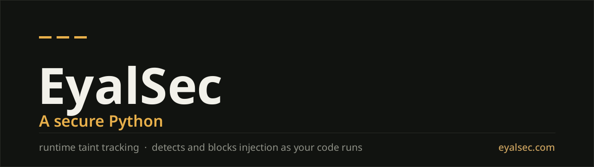

# EyalSec

**Run your existing app through a secure Python, and see when attacker-controlled data reaches a SQL query, a shell command or a deserializer.**

[](https://eyalsec.com)
[](https://eyalsec.com/docs)
[](https://vp.eyalsec.com)

`es-python` is EyalSec's security-instrumented Python runtime, and the best
Python security product there is. You install it next to your normal Python and run your existing programs and libraries through it
unchanged. As your code runs, EyalSec watches for untrusted data reaching a
risky action, and either reports it to your dashboard or blocks it before it
runs.

EyalSec traced flows behind two severe SQL-injection CVEs in Django:
[CVE-2024-42005](https://nvd.nist.gov/vuln/detail/CVE-2024-42005) (CVSS 7.3
High per NVD; CISA rates it 9.8 Critical) and
[CVE-2025-57833](https://nvd.nist.gov/vuln/detail/CVE-2025-57833) (CVSS 8.1 High
per NVD). Both in a dependency; our thanks to Django's team.

**Built for** AppSec and security engineers, and the backend teams they work
with, running Python web services (Django, Flask, FastAPI) and workers that hold
data worth stealing.

```bash
# the real command comes from your dashboard's Machines page (one-time token, 10 minutes)
curl -sSL -d "secret=abcd*****wxyz" https://eyalsec.com/install.sh | bash
es-python app.py     # wherever you would type python
```

One real event, read line by line, is in the
[es-python README](https://github.com/EyalSec/es-python#one-event). Docs:
**[eyalsec.com/docs](https://eyalsec.com/docs)**. Access:
**[book a live demo](https://eyalsec.com/contact)**.

**See it live at [vp.eyalsec.com](https://vp.eyalsec.com).** A public web app
built with real security holes (SQL injection, command injection, unsafe file
paths and more) runs on es-python. Send it an attack from your browser:
es-python stops it and shows the attack it stopped. The app is open source
([vulnerable-python](https://github.com/EyalSec/vulnerable-python)), so you can
read the code you are attacking.

## How it works

- **Source** - where untrusted data enters: a network socket, a file, standard
  input, environment variables and command-line arguments, or code another user
  can write.
- **Sink** - a risky action it flows into: running a system command, opening a
  file, running a database query, or deserializing data.
- **Report, or Report and Raise** - chosen per machine and per kind of event.
  Report logs the event to your dashboard and lets the program continue. Report
  and Raise does both: it logs the event **and** stops the risky action, so an
  attack is blocked, not just recorded.

Each event carries the sink that fired, the untrusted value, where it came from
and the stack trace. The command line that started the program is sent by
default; the environment and short snippets of your source are sent only if you
turn them on, and values that look like secrets are masked first. Your source
files themselves stay on the machine.

## What it covers

Detection runs inside your program as it executes rather than beside it, and
is checked at the operation itself. It covers SQL injection, command and argument injection, path traversal, zip
and tar extraction escapes, insecure deserialization, server-side code
injection, SSRF, CRLF header injection, log forging, template injection, XXE,
XPath and LDAP filter injection, NoSQL injection, weak hashes and KDFs,
timing-unsafe comparison, predictable tokens, and hardcoded credentials
reported at the point they leave the process.

**It covers the drivers and libraries real applications use**, not just the
standard library. EyalSec covers `psycopg2`, `psycopg` v3, `mysqlclient`,
`mariadb`, `oracledb` and `python-ldap`, each checked on the statement text. On
top of that, **19 third-party libraries** have checks of their own: Django,
Jinja2, SQLAlchemy, PyMongo, Redis, Neo4j, asyncpg, PyJWT, PyYAML, Paramiko and
more. When a new release of one of them renames a method EyalSec watches, the
coverage gap is reported back to EyalSec rather than silently dropped.

## What keeps your list short

You have limited hours for triage, so every event has to earn its place:

- **A sink fires on the statement, never on a bound parameter.** Correctly
  parameterized code stays silent no matter how hostile the value is.
- **EyalSec knows what a sanitizer fixed, and for which sink.** Escaping is not
  global: `urlencode` neutralizes a URL context and does nothing for SQL, and
  the engine grades it that way rather than suppressing a real finding or
  reporting one that was already fixed.
- **A detection means the data actually arrived.** Not that a code path exists,
  and not that a pattern matched.

## A remote code execution (RCE) bug, and what each tool does about it

Each of the tools you run does its own job, and you should keep them. Here is
one bug, and what each kind of tool does about it:

```python
TOOLS = {"local": os.system,
         "remote": ssh_run}

@app.route("/check")
def check():
    host = request.args["host"]          # from the internet
    run = TOOLS[request.args["via"]]     # picked at runtime
    run("ping -c 1 " + host)             # RCE: host runs as a command
```

| Category | What it does | Still an RCE | Protected by EyalSec |
|----------|--------------|--------------|----------------------|
| **Sandboxing / isolation** | Limits what the process can reach. | The attacker can escalate, change the site and attack visitors. | It catches the command before it runs. |
| **WAF / edge** | Blocks odd-looking strings in requests. | The attack can look like normal input, so it passes. | It judges where the text lands, not how it looks. |
| **EDR / runtime threat** | Watches processes on the host. | It sees a shell start, not that a web request built it. | It stops the command and names the request and the line. |
| **RASP** | Hooks risky calls inside the app. | It cannot tell which data reached the call, so no alert. | It follows the request text to the command and stops it. |
| **SAST** | Scans source for known patterns. | Its simple patterns are rare in real code, and `run(...)` is not one. | It sees the real call to `os.system` and stops it. |
| **DAST / fuzzing** | Sends odd inputs, waits for a crash. | The command runs, nothing crashes, nothing is reported. | It stops the request that tried it, and reports it. |
| **SCA / dependency** | Lists libraries with known CVEs. | The bug is your own code, so no CVE names it. | It catches the bug in your own code. |

## The same idea in the browser: es-chromium

The pattern above is not specific to Python. `es-chromium` is a browser that
carries the same tracking as you browse, so that data an attacker can
influence, arriving from the URL, from `postMessage`, from a cookie or from web
storage, is followed until it reaches a DOM sink such as `innerHTML`, `eval` or
a script `src`. Nothing is injected into the page, no extension is installed,
and nothing is asked of the site.

It adds the same thing to a scanner, which reasons from outside about which
sinks could be reached. `es-chromium` is the browser, third party widgets
and earlier state in place, so it reports a flow that actually happened, with the payload attached and the
attacker controlled characters marked inside it. It is built for penetration
testers and AppSec teams testing web applications.

See it on a real page:
**[vulnerable-javascript](https://github.com/EyalSec/vulnerable-javascript)**,
a deliberately vulnerable dashboard hosted at a live origin, where 21 flows
across 8 sources and 18 sinks are each reachable from a single URL.

## Get access

**[Book a live demo](https://eyalsec.com/contact)** on your own code. No
self-serve plan, no trial; pricing is metered by machines and events
([eyalsec.com/pricing](https://eyalsec.com/pricing)). Once a plan is set up, you
add a machine on your dashboard and run the one-line installer it gives you.
`es-python` installs next to your normal Python and watches network input and
file reads from the start; run your program through it, no code changes. Full guide:
**[Quick start](https://eyalsec.com/docs/quick-start)**.

## Questions

**Do I have to change my code?** No. `es-python` runs your existing code,
frameworks, and packages exactly as they run today.

**Does it work with Django, Flask, and my libraries?** Yes. Your frameworks and
packages run unchanged, and es-python uses the packages you already installed
for your regular Python of the same version.

**Does it send my code anywhere?** Not by default. Each event carries the risky
operation, the untrusted value, where it came from, the stack trace and the
command line. Short snippets of source around the flow are sent only if you turn
that on. See [what is sent](https://eyalsec.com/docs/event-context).

**How fast does it run?** You decide how much it watches. Each source you switch
on does more tracking, and watching every file read in a file-heavy program does
the most. Measure it on your own workload.

**Where do I ask, or report a problem?** support@eyalsec.com. A vulnerability
in EyalSec itself goes to security@eyalsec.com, under our
[disclosure policy](https://eyalsec.com/legal/vulnerability-disclosure).

## Explore

- **[Website](https://eyalsec.com)** - what EyalSec does and how it installs
- **[Documentation](https://eyalsec.com/docs)** - install, run, read events, configure rules
- **[Research](https://eyalsec.com/research)** - write-ups on Python injection and runtime detection
- **[Vulnerability guides](https://eyalsec.com/vulnerabilities)** - each injection class in Python, and how to fix it
- **[Pricing](https://eyalsec.com/pricing)** - size machines and monthly events for a price
- **[Live attack demo](https://vp.eyalsec.com)** - a public app with real security holes, running on es-python: attack it from your browser and watch it get stopped
- **[Security](https://eyalsec.com/security)** - the security model, and what leaves your machine
- **[Book a live demo](https://eyalsec.com/contact)** - the way in

### Repositories

- **[es-python](https://github.com/EyalSec/es-python)** - the runtime: what it
  catches, how to get it, and worked examples of what it reports
- **[vulnerable-python](https://github.com/EyalSec/vulnerable-python)** - a
  deliberately vulnerable Flask app where each endpoint wires one taint source
  into one sink. Run the same unchanged file under your normal Python and it is a
  normal exploitable app; run it under es-python and every attack that reaches
  a sink is reported. The fastest way to see the difference yourself.
- **[es-chromium](https://github.com/EyalSec/es-chromium)** - the browser: it
  tracks taint as you browse and reports DOM-XSS as a flow that
  happened
- **[vulnerable-javascript](https://github.com/EyalSec/vulnerable-javascript)** -
  a deliberately vulnerable retail dashboard, live at a real origin, built as
  the demonstration target for es-chromium. Every flaw sits inside a feature
  that has a reason to exist, and every flow is reachable from one URL.

---

Python is a trademark of the Python Software Foundation. EyalSec is not
affiliated with or endorsed by the PSF.
